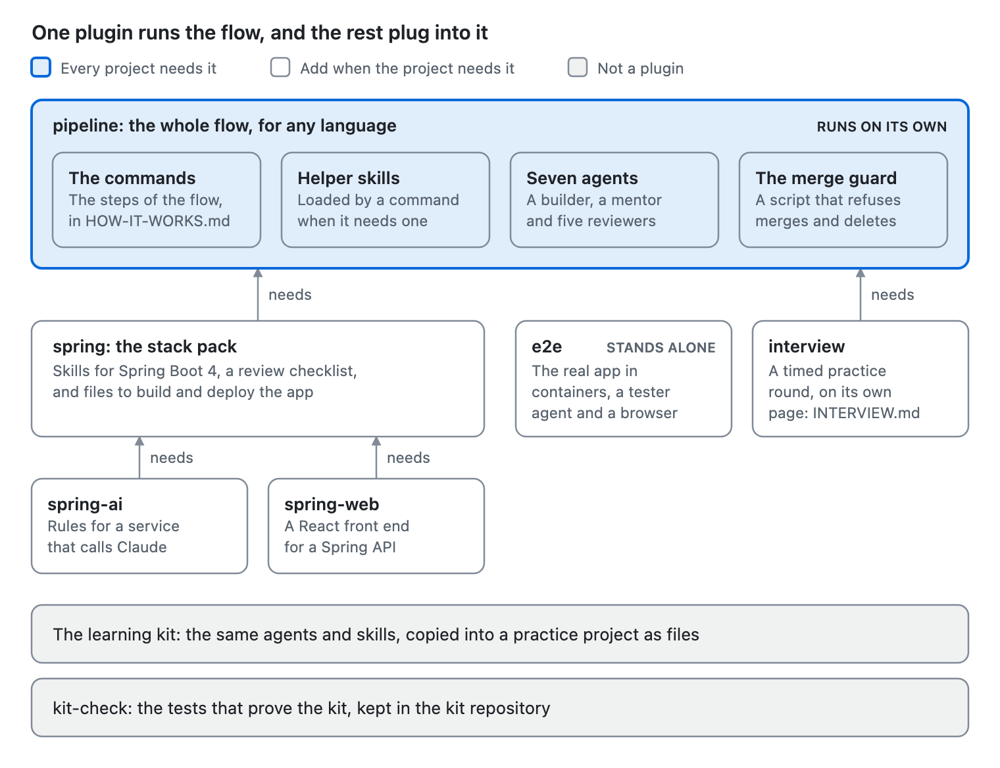
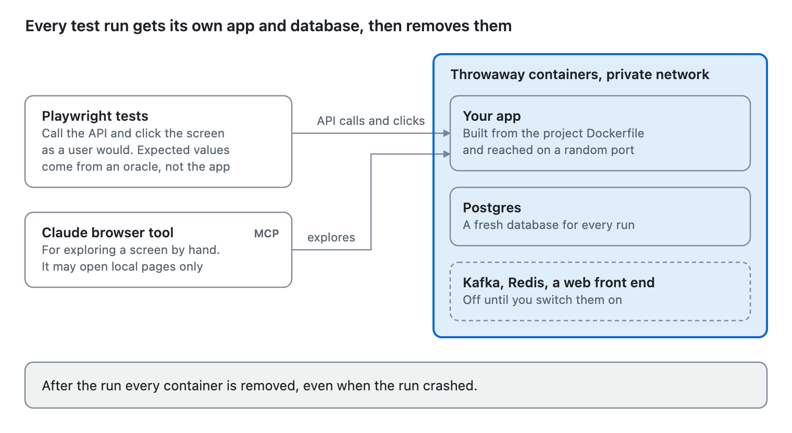
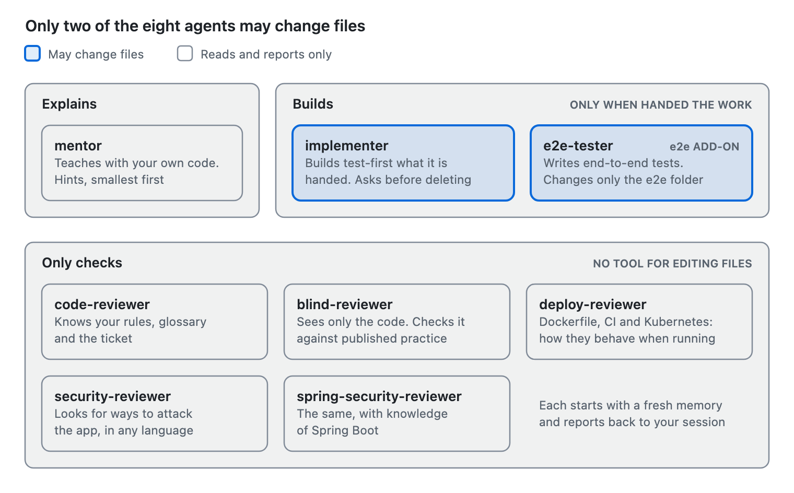
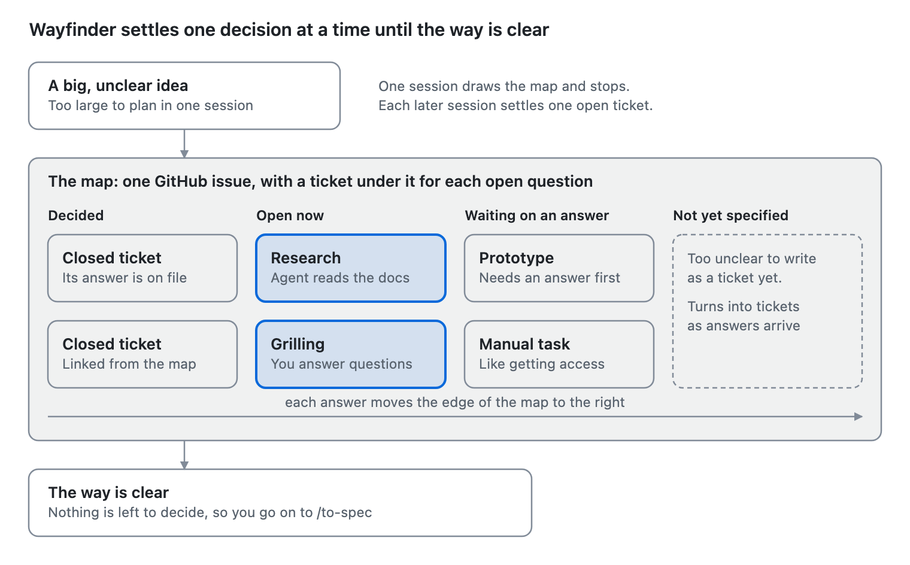
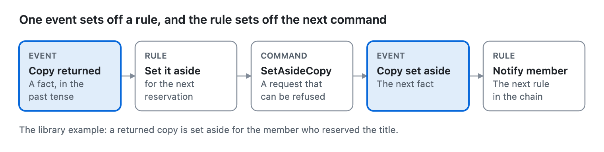
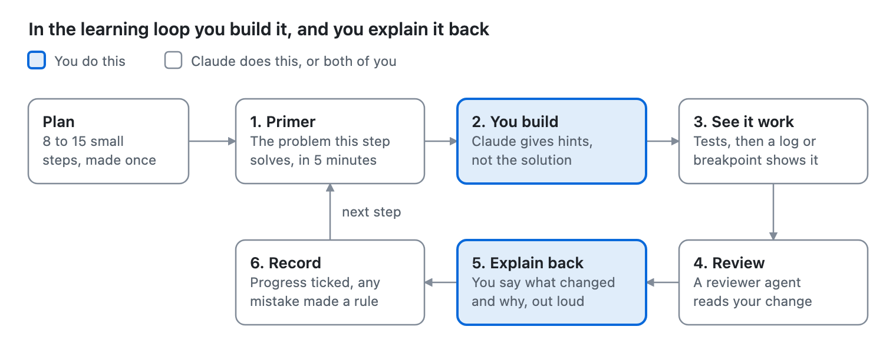

# Beyond the flow, in plain words

Everything around the flow's commands, explained simply: the kinds of piece, the stack pack, the add-ons, the agents,
the helper skills, the learning kit and the proofs. Read [HOW-IT-WORKS.md](HOW-IT-WORKS.md) first. [GUIDE.md](GUIDE.md)
then has the full detail.

**Jump to:** [What this covers](#what-this-page-covers) · [One picture](#the-whole-kit-in-one-picture) ·
[The four kinds of piece](#the-four-kinds-of-piece) · [Install](#two-ways-to-install) ·
[The stack pack](#the-stack-pack-spring) · [The add-ons](#the-add-ons-e2e-spring-ai-spring-web) ·
[The agents](#the-agents-one-by-one) · [The helper skills](#the-helper-skills) · [The learning kit](#the-learning-kit) ·
[What is proved](#what-is-proved) · [Changing the kit](#changing-the-kit-safely) · [Cheat sheet](#cheat-sheet)

## What this page covers

[HOW-IT-WORKS.md](HOW-IT-WORKS.md) explained the commands of the flow. This page explains what those commands stand on,
and the parts you add only when a project needs them.

The `pipeline` plugin alone runs the whole flow, in any language. Everything else is optional, and each part exists to
close one gap.

| Part | In one line | You need it when |
| --- | --- | --- |
| The four kinds of piece | Skill, agent, hook and MCP server: what each one is | You want the rest of this page to make sense |
| Two ways to install | As a plugin that updates, or as files copied into the project | You set up a repo |
| The stack pack | Rules, a review checklist and build files for one framework | The project is Spring Boot |
| The add-ons | Browser tests, Claude inside your own service, a React front end | The project has a screen, calls a model, or needs a UI |
| The agents | Eight separate Claudes, each with one narrow job | You want a second opinion, or work done for you |
| The helper skills | Knowledge the commands load without you asking | The work is vague, event-driven, or a bug hunt |
| The learning kit | A way of working where you write the code and Claude teaches | The goal is to learn, not to ship |
| The proofs | Tests that show the kit's own claims hold | You wonder how far to trust it |

The `interview` plugin is not covered here. It has its own page, [INTERVIEW.md](INTERVIEW.md).

## The whole kit in one picture

The kit is six plugins and two parts that are not plugins. Only `pipeline` is needed by every project.

<picture>
  <source media="(prefers-color-scheme: dark)" srcset="docs/assets/how-it-works/kit-dark.png">
  
</picture>

An arrow means "needs": install the plugin it points to first. `/setup-project` does this for you in a Spring Boot repo.

## The four kinds of piece

Everything in the kit is one of four kinds, and the kind tells you who decides when it runs.

<picture>
  <source media="(prefers-color-scheme: dark)" srcset="docs/assets/how-it-works/kinds-dark.png">
  
</picture>

A skill only adds to what your session knows. The other three are separate from it, and only the hook can say no.

| Kind | What it is | Who starts it | How firmly it holds |
| --- | --- | --- | --- |
| Skill | A file of written steps or knowledge | You, by typing its command. Or Claude, when the topic comes up | Told: Claude follows what is written |
| Agent | A separate Claude with one job, its own tools and a fresh memory | Your session hands it a task, or you name it | Second agent: it has no stake in the first one's work |
| Hook | A script that Claude Code runs before a tool call | Claude Code itself, every time | Blocked: the script can refuse the call |
| MCP server | A program that lends Claude a new tool | You approve it once for the project | An allow-list that stops accidents, not a wall |

### Skill

**In one line:** a skill changes what Claude knows or the steps it follows, and does nothing by itself.

- **Two sorts.** A command skill is one you type, such as `/pipeline:implement`. A knowledge skill loads by topic: ask
  about transactions and Claude reads `transactions`.
- **Why it exists.** Claude's general knowledge is wide, but it is not pinned to your framework's version or your team's
  way of working. A skill pins it down in writing.
- **What you control.** The flow's commands are marked so that only you can start them. Claude cannot decide to run
  `/implement` or `/deploy` on its own.
- **In a normal team:** the runbook and the team wiki.

### Agent

**In one line:** an agent is a second Claude that knows only its brief and reports back when done.

- **What it starts with.** Its own instructions, its own tool list, and the project's `CLAUDE.md`. It does not see your
  conversation.
- **Why it exists.** A Claude that has just written code will defend it. One that starts fresh judges only what is on
  the page.
- **What limits it.** Its tool list. A reviewer is given no tool for writing or editing files, and its brief says to
  change nothing.
- **In a normal team:** a colleague you hand one task to.

### Hook

**In one line:** a hook is a script outside Claude, so no wording in a chat can talk it out of its answer.

- **The kit has one:** the merge guard. Claude Code runs it before every shell command, and it refuses merges, pushes to
  `main`, force pushes and commands that throw work away.
- **Why it exists.** A written rule can be broken on a bad day. A script cannot be persuaded.
- **In a normal team:** branch permissions, applied on your own machine.

### MCP server

**In one line:** an MCP server gives Claude a tool it does not have, such as a real browser.

- **The kit has one:** the Playwright MCP, which comes with the `e2e` add-on. Claude can open a page, click, and read
  what is on screen.
- **What limits it.** It may only open pages on your own machine. That setting stops accidents. It is not a security
  boundary, so only ever point it at a local test stack.
- **In a normal team:** giving a tester a browser and a test environment.

### When each one loads

- Skills and agents load when a session starts. After installing one, restart `claude`.
- `CLAUDE.md` is read into every session and into every agent. The one exception is the blind reviewer, which is set up
  to skip it. That is how it stays blind.
- An MCP server asks for your approval the first time, and again on a new machine or account.

**More detail:** [7 How Claude Code loads all this](GUIDE.md#7-how-claude-code-loads-all-this-facts-worth-knowing).

## Two ways to install

A project gets the kit either as a plugin that stays linked to this repository, or as files copied in once. Use the
plugin for delivery work and the copy for a practice project.

|  | Plugin | Copy |
| --- | --- | --- |
| You run | `claude plugin install pipeline@kits --scope project` | `./spring-boot-learning/install.sh <project>` |
| What the project receives | One line in `.claude/settings.json` that names the plugin | The agents, skills and a `CLAUDE.md`, as files in the project |
| How you type a command | With the plugin's name: `/pipeline:next` | Without it: `/learning-loop` |
| How an improvement arrives | `claude plugin update` | Run `install.sh` again with `--force`, then check `git diff` |
| Your teammates | Get the same plugins from the settings file | Get the files with the repo |
| Works for | Any language | Spring Boot practice projects |

**Why two.** A plugin keeps every project on the same version of the flow, which is what you want when shipping. A copy
belongs to the project, so a learner can open each file, read it and change it.

### The three scripts

| Script | In one line | What it will not do |
| --- | --- | --- |
| `setup.sh` | Run once per machine. It checks that the tools the kit needs are installed | Install anything for you |
| `new-project.sh <name>` | Creates a new Spring Boot 4 project from start.spring.io and installs the kit into it | Reuse a folder that already exists |
| `install.sh <project>` | Copies the learning kit into a project you already have | Overwrite a file. An existing `CLAUDE.md` is kept, and the kit's version lands beside it as `CLAUDE.learning.md` |

`install.sh --dry-run` lists what would be added and writes nothing. Run that first on any project you care about.

**In a normal team:** the plugin is a shared tool the whole team upgrades together. The copy is a starter template you
fork and make your own.

**More detail:** [2 Quick starts](GUIDE.md#2-quick-starts), [3.1 new-project.sh](GUIDE.md#31-new-projectsh) and [3.2
install.sh](GUIDE.md#32-installsh).

## The stack pack: `spring`

**In one line:** a pack adds what is true for one framework, so the flow stops being generic.

- **What it does.** The flow knows how to plan, build test-first, review and ship. It does not know Spring Boot 4. The
  pack supplies that: skills for the framework, a review checklist, and build and deploy files.
- **Why it exists.** An agent's memory of a framework is a mix of versions. It will write code that was right two
  releases ago. The pack's skills are written for one version, and the code in them runs as tests.
- **How it connects.** `/setup-project` detects Spring Boot, installs the pack, and writes its name on the stack card.
  From then on the builder reads the pack's skills, and the project reviewer applies the pack's checklist.
- **In a normal team:** the framework guide and the platform team's starter templates.

| The pack adds | What it holds |
| --- | --- |
| Framework skills | `spring-boot`, `testing-patterns`, `transactions`, `jpa-patterns`, `logging-patterns` |
| Language skills | `java-modern`, `java-concurrency` |
| A review checklist | The Spring-specific points the project reviewer checks on every change |
| Build and deploy files | A Dockerfile, a CI workflow, Kubernetes files for staging and production, and the deploy workflow that `/deploy` starts from |

**With no pack.** Every command, every agent and the merge guard work the same. What is missing is the framework
knowledge, so you put your stack's rules in `CODING_STANDARDS.md` and the reviewer reads those. There is one pack today.
A TypeScript pack is an idea, not yet built.

**More detail:** [1 What exists](GUIDE.md#1-what-exists).

## The add-ons: `e2e`, `spring-ai`, `spring-web`

Each add-on closes one gap the core flow leaves open: proving the whole app works, calling a model safely, and having a
screen.

| Add-on | Add it when | Needs |
| --- | --- | --- |
| `e2e` | The app has a screen, or a flow that crosses several parts | Nothing else. It works with any app that runs in a container |
| `spring-ai` | Your own service calls Claude | The `spring` pack |
| `spring-web` | A Spring API needs a front end | The `spring` pack |

Add one with `claude plugin install <name>@kits --scope project`. In a copy install, the flags are `--e2e`, `--ai` and
`--web`.

### `e2e`: tests that use the real app

**In one line:** it starts your whole app with a real database in throwaway containers, and tests it the way a user
would.

<picture>
  <source media="(prefers-color-scheme: dark)" srcset="docs/assets/how-it-works/e2e-dark.png">
  
</picture>

- **What it does.** It runs your app's image beside Postgres, and Kafka, Redis or a web front end if you switch them on.
  Playwright tests then go through the API and the browser. Every run gets fresh databases, and everything is removed
  afterwards, even after a crash.
- **Why it exists.** A unit test written by the agent that wrote the code tends to agree with the code. An end-to-end
  test checks what a user would actually see.
- **How it stays honest.** The expected value in a test comes from an independent source, called an oracle. It is never
  copied from what the app returned. A test that only repeats the app's own answer proves nothing.
- **The other rules.** Wait for a condition, never for a fixed time. Find things on screen the way a user would, by role
  and label. A new test must pass many times in a row before it counts.
- **In a normal team:** the regression suite and the test environment a QA engineer keeps.

The add-on brings one agent and one tool:

- **The `e2e-tester` agent** plans scenarios, writes tests and repairs failing ones. It changes only files in `e2e/`. A
  bug the tests reveal is reported with a way to reproduce it, and the test is not bent to match.
- **The browser tool** lets Claude open your local app, click through it and read the screen. Use it to explore and to
  find the right names for things. The written test suite is what runs in CI, not the browser tool.

### `spring-ai`: when your own service calls Claude

**In one line:** it holds the engineering rules around a model call, so the feature is safe, tested and has a known
cost.

- **What it does.** One skill, `llm-engineering`, covers the parts people skip: answers in a fixed structure, text from
  users treated as hostile, what to do when the model stops early or refuses, retries and timeouts, cost per call, logs
  with no personal data, and tests that grade the model's answers.
- **Why it exists.** A model call fails in ways ordinary code does not. Text it reads can steer it. It can stop
  half-way. It can return something that looks right and is wrong.
- **How it is used.** The reviewers apply its checklist whenever a change calls a model. With `e2e` installed, tests run
  against a local stand-in for the model, so they need no key and cost nothing.
- **In a normal team:** the security and cost review a new outside service goes through.

### `spring-web`: a front end

**In one line:** a ready React front end for a Spring API, built so the browser tests can find things in it.

- **What it does.** It adds a `web/` folder with React, Vite and TanStack Query, served by nginx, which passes `/api`
  calls on to your service.
- **Why it exists.** An agent asked for "a front end" builds a different shape every time. A template gives one known
  shape, with loading, error and empty states already handled.
- **How it fits the tests.** Buttons and fields carry proper accessible names. The `e2e` tests find them by those names,
  the same way a screen reader does.
- **In a normal team:** the front-end starter kit.

**More detail:** [3.6 End-to-end tests](GUIDE.md#36-end-to-end-tests---e2e) and [3.7 The Playwright
MCP](GUIDE.md#37-the-playwright-mcp).

## The agents, one by one

There are eight agents: one explains, two build, and five only check. Seven come with `pipeline`, and `e2e-tester` comes
with the `e2e` add-on.

In the flow you never call them. `/implement` starts the builder and the reviewers for you. Outside the flow, you call
one by name in plain words: "use the blind-reviewer on my changes".

<picture>
  <source media="(prefers-color-scheme: dark)" srcset="docs/assets/how-it-works/agents-dark.png">
  
</picture>

| Agent | Its one job | What it may change | What makes it different |
| --- | --- | --- | --- |
| `mentor` | Explains a concept using your own code, and gives hints, smallest first | Nothing | It gives the full answer only when you ask for it |
| `implementer` | Builds what it is handed, test-first | Code, but only when `/implement` or you hand it the work | It asks before adding a dependency or deleting a file, and it never merges |
| `code-reviewer` | Reviews a change with everything the project has written down | Nothing | Two separate passes: your standards, then the ticket |
| `blind-reviewer` | Reviews a change knowing nothing about the project | Nothing | It reads no documentation and ignores any description you give it |
| `security-reviewer` | Looks for ways to attack the app, in any language | Nothing | Each finding is a concrete attack, and it never opens a file of real secrets |
| `spring-security-reviewer` | The same, for a Spring Boot app | Nothing | It knows Spring's annotations, settings and built-in endpoints |
| `deploy-reviewer` | Reads a Dockerfile, CI workflow or Kubernetes files and says how they behave when running | Nothing | It never builds, deploys or applies anything |
| `e2e-tester` | Plans, writes and repairs end-to-end tests | Only files in `e2e/` | It can drive a browser, and only against your local test stack |

### Why two reviewers, and not one better one

**In one line:** each reviewer is blind to something on purpose, and the two blind spots do not overlap.

- **The project reviewer** knows your rules, your glossary and the ticket. It catches "this breaks our standard" and
  "nobody asked for this". Its weakness is that it believes what the documents say.
- **The blind reviewer** has only the code. It works out the language, the framework versions and the design from the
  files, then checks the change against published best practice for that stack. It catches what the code really does,
  whatever anyone claimed. Its weakness is that it does not know your rules.
- **The measurement.** In a blind-graded comparison the two tied on points, and each found defects the other missed. So
  both are kept.

### What "read-only" really means here

A checking agent is given no tool for writing or editing files, and its instructions say to change nothing. It does have
a shell, which it needs to find files and run the tests. So "read-only" is partly enforced and partly told. What is
fully enforced sits one layer down: the merge guard and GitHub's rule, which no agent can get past.

### Calling one yourself

| You say | You get |
| --- | --- |
| "ask the mentor why my query runs 4 times" | An explanation that points at your own code |
| "use the implementer to add docker compose with Postgres" | The change, its tests, and an explanation of what it did |
| "use the code-reviewer agent on my changes" | At most 8 findings per pass, each with the rule it breaks |
| "use the blind-reviewer on my changes" | What it worked out about the stack, then findings with a cited source |
| "use the security-reviewer agent" | Attack scenarios, access control first |
| "use the deploy-reviewer agent on my Dockerfile" | What the file does at runtime, and what will go wrong |
| "use the e2e-tester agent to plan scenarios for the order API" | A list of scenarios from exploring the running app |

Give the blind reviewer only a scope, such as "my changes" or a folder. Telling it what the feature is for defeats the
point, and it will say so and ignore the description.

**More detail:** [3.4 The agents](GUIDE.md#34-the-agents).

## The helper skills

You rarely type these. A command or an agent loads the helper it needs at the moment it needs it, which is why the
commands themselves stay short.

Two of them change how planning starts, so they get a full explanation. The rest fit in a table.

### `/pipeline:wayfinder`: when the idea is too big to plan in one sitting

**In one line:** it turns a large, unclear idea into a map of open decisions, and settles them one at a time.

<picture>
  <source media="(prefers-color-scheme: dark)" srcset="docs/assets/how-it-works/wayfinder-dark.png">
  
</picture>

- **What it does.** The map is one GitHub issue. Each open question becomes a small ticket under it. A ticket is one of
  four kinds: research (an agent reads the sources), prototype (something rough to react to), grilling (a conversation
  with you), or a manual task that unblocks a decision.
- **Why it exists.** Give an agent a big idea in one go and it returns a confident plan built on guesses. Wayfinder will
  not plan what it cannot yet see. The unclear parts are written down as "not yet specified" and wait until earlier
  answers make them clear.
- **How it works.** One session draws the map and stops. Each later session settles one ticket, records the answer and
  closes it. It decides and does not build. When nothing is left to decide, you go on to `/to-spec`.
- **When to skip it.** If the idea fits one planning session, `/grill-with-docs` is enough, and wayfinder tells you so.
- **In a normal team:** the discovery phase, with its list of spikes and open questions.

This is the one helper you type yourself.

### `event-storming`: when things happen over time

**In one line:** it lays a domain out as events, commands and rules before anyone designs a screen or a table.

<picture>
  <source media="(prefers-color-scheme: dark)" srcset="docs/assets/how-it-works/event-chain-dark.png">
  
</picture>

- **When it applies.** Several kinds of user, things that happen in sequence, or reactions in the background, such as
  "whenever a copy is returned, set it aside for the next reservation". For a simple form over one table it says so and
  steps aside.
- **What it does.** It joins the `/grill-with-docs` session and works down four levels: the whole timeline of events,
  then each flow, then each command, then how the parts group into modules. You decide every item. Claude asks and
  recommends.
- **What it writes.** Four files in `docs/eventstorming/`. Each command gets a card with Given, When, Then examples of
  how it must behave. Every name on the board is also a glossary word.
- **How it is checked.** A fresh agent audits the board against a checklist, reading the files and not Claude's summary.
  The board is done when the audit comes back clean.
- **In a normal team:** an Event Storming workshop, the one with the wall of sticky notes.

### The rest, by who loads them

| Helper | Loaded by | What it brings | The agent habit it corrects |
| --- | --- | --- | --- |
| `grilling`, `domain-modeling` | `/grill-with-docs` | Questions in rounds, and the glossary written as you go | Building on a guess |
| `research` | Wayfinder, or you | A background agent reads official documentation and source code, and writes up findings with every claim cited | Answering from memory of an old version |
| `prototype` | Wayfinder, or you | Throwaway code that answers one question: does this logic feel right, or what should this look like | Polishing a design nobody has tried |
| `tdd` | The builder | A failing test first, then just enough code, one slice at a time | Tests written afterwards to match the code |
| `codebase-design` | The builder | Shared words for module design: a small interface with a lot behind it | Many thin layers that are hard to test |
| `diagnosing-bugs` | The builder, or you say "diagnose this" | Build a fast, repeatable check that fails on this bug before guessing at a cause | Staring at code and guessing |
| `pr` | `/implement` | The pull request layout: the change as a picture, proof, and merge danger | A wall of text nobody reads |
| `wizard` | `/deploy` | A script that walks you through steps only you can do, such as secrets and accounts. You type secret values in your own terminal | Asking you to paste a secret into the chat |
| `writing-for-agents` | `/retro` | How to word a rule so an agent follows it the same way every time | Rules that are vague, so they are followed sometimes |

### Knowledge that loads by topic

Four more skills hold design knowledge. Claude reads one when the work touches its subject, or when you name it.

| Skill | Loads when the work is about |
| --- | --- |
| `system-design` | Sizing a system, capacity at 1, 10 and 100 times the load, and choosing building blocks |
| `distributed-systems` | Messages arriving twice, out of order or never, caches, locks and consistency |
| `design-patterns` | How components exchange data and stay consistent: the outbox, idempotent consumers, sagas |
| `resilience-patterns` | Calling another service safely: timeouts first, then retries, then circuit breakers |

**More detail:** [3.5 The skills](GUIDE.md#35-the-skills) and, for Event Storming, [step 2 of the
flow](PIPELINE.md#2-event-storming).

## The learning kit

**In one line:** the same agents and skills, set up so that you write the code and Claude teaches.

- **What it is.** A working agreement in `CLAUDE.md`, two small files that hold your progress and your lessons, the
  command `/learning-loop`, and the `mentor` agent.
- **Why it exists.** The delivery flow is built to ship safely, so it hands the typing to Claude. Learning needs the
  opposite. You build it, get stuck a little, see it work, and then explain it back.
- **How it works.** You make a plan once. Then the same six steps repeat for each piece of work, as shown below. Claude
  reads your progress and lessons files first, so it knows where you stopped and what you got wrong before.
- **In a normal team:** pairing with a senior engineer who refuses to take the keyboard.

<picture>
  <source media="(prefers-color-scheme: dark)" srcset="docs/assets/how-it-works/learning-loop-dark.png">
  
</picture>

### What makes it teaching, and not just slow delivery

- **Hints, smallest first.** When you are stuck, the mentor gives a question, then the name of the concept, then where
  to look, then a skeleton with blanks. You get the full answer only when you ask for it.
- **Explain before code.** For anything new you get the problem, the options and the trade-off first, then a small
  example.
- **See it work.** Passing tests are not enough. You make the behaviour visible with a breakpoint, a SQL log or a
  request, and sometimes you break it on purpose to watch it fail.
- **Explain it back.** You describe the change in three to five sentences, as you would to a colleague. Claude points
  out what you left out.
- **Watch, then do.** For a pattern you have never seen, Claude builds one small example and explains each line. You
  then build the next one alone.

### The files it keeps

| File | What it holds | When it is read |
| --- | --- | --- |
| `CLAUDE.md` | The agreement: you write the production code, small steps, a review after every feature, ask before adding dependencies or deleting files | At the start of every session |
| `docs/learning/PROGRESS.md` | The plan of 8 to 15 steps, what you can now explain, and anything the builder agent did for you | At the start of every session |
| `docs/learning/LESSONS.md` | Each mistake, turned into a one-line rule | At the start of every session |

### When you want something done for you

Some steps are not the point of the exercise: a compose file, CI, boilerplate. Say "use the implementer to add docker
compose with Postgres". It builds it, explains what it did, and leaves you a similar task to do yourself. Claude never
hands a learning step to the builder without asking you.

### `/interview-drill`

**In one line:** it turns the project you built into interview practice.

- **What it does.** It asks about your own code, one question at a time, and waits. It starts concrete, then pushes on
  your decisions, then on scale: "ten times the traffic: what breaks first, and how do you know?"
- **How it scores.** Short feedback after each answer, measured against what a senior or staff engineer is expected to
  say.
- **In a normal team:** a mock interview with a colleague who has read your code.

### Learning kit or delivery flow?

|  | Learning kit | Delivery flow |
| --- | --- | --- |
| The goal | You can explain every line | A reviewed change in production |
| Who writes the code | You | Claude, in blocks or whole tickets |
| The unit of work | One step of your plan | One ticket, one pull request |
| Who reviews | The project reviewer, and its findings come as hints | Two reviewers, then you |
| Where the record lives | `PROGRESS.md` and `LESSONS.md` | GitHub issues, pull requests and review records |
| Installed as | A copy | A plugin |

The two meet in the flow's **learn** mode. There, `/implement` runs this same loop for the ticket, so you can learn
inside a project that also ships.

**More detail:** [3.3 CLAUDE.md and the learning files](GUIDE.md#33-claudemd-and-the-learning-files) and [4.1 A normal
learning session](GUIDE.md#41-a-normal-learning-session).

## What is proved

Each claim the kit makes about itself is backed by a check you can run. The checks live in
`spring-boot-learning/kit-check/`.

**Why it exists.** A skill is advice an agent will follow without questioning. If the advice is wrong for the current
version, every project gets the same wrong code. So the kit holds itself to the rule it sets for the builder: no claim
without a test or a cited source.

| The claim | How it is checked | The check |
| --- | --- | --- |
| The code in the Spring and AI skills works | 44 tests run it on Spring Boot 4.1.1 against a real Postgres, and 23 more run the model code against a local stand-in | `./mvnw verify` |
| The build and deploy files work | They are built and run. With a local cluster: a release, a broken release that leaves the old version serving, and an undo | `verify-templates.sh` |
| The merge guard blocks the right things | It is fed 22 dangerous commands and 15 safe ones | `verify-pipeline.sh` |
| `/next` names the right step | It is run against 26 different repo states | `verify-pipeline.sh` |
| The adopted skills are unchanged | They are compared with Matt Pocock's originals, byte for byte | `verify-pipeline.sh` |
| Two reviewers beat one | A blind-graded comparison on code with known defects. They tied, and each found things the other missed | `reviewer-eval/` |
| The rewritten project reviewer is better | It found all 10 planted defects in every run, and scored 31.8 against 27.2 for the version it replaced | `reviewer-eval/` |
| The explorer reads code correctly on a cheaper model | Three models read an 11-service app and were scored against an answer key taken from the code. The mid-size model found everything at half the cost | `explorer-eval/` |
| The add-ons install and run | Each is installed into a copy of a project and run end to end | `verify-e2e.sh`, `verify-ai.sh`, `verify-web.sh` |

None of these calls the real model or needs a key.

### How a changed agent is judged

An agent that replaces another has to win a fair comparison first.

1. Take a copy of a project with known defects, with the documents that describe them removed.
2. Write the answer key and the scoring rules before reading any result.
3. Run each version three times with the same request.
4. Strip everything that identifies which version wrote each report.
5. Have a separate agent grade the reports.
6. Reveal which was which. A winner needs a lead of at least 2 points and 15%. Anything less is a draw, and on a draw
   both are kept.

**In a normal team:** an A/B test where the judges do not know which is A.

**More detail:** [10 Proofs](GUIDE.md#10-proofs) and [3.10 The reviewer
evaluation](GUIDE.md#310-the-reviewer-evaluation).

## Changing the kit safely

The kit is one repository, so every improvement is a commit you can read or undo. Five rules keep a change from quietly
making every project worse.

1. **Edit the kit, never a project's copy.** A fix made inside one project is lost at the next install, and no other
   project gets it.
2. **Prove any code you add.** A new code example in a skill gets a test in `kit-check` first. Anything about timing or
   threads is run at least five times.
3. **Leave the adopted skills alone.** The fifteen in `upstream/` are pinned to one commit of Matt Pocock's repository,
   and a script fails if they differ. Taking his newer version is its own pull request.
4. **Give an agent the fewest tools that do the job.** A reviewer gets no tool for writing files.
5. **Measure before replacing an agent.** Use the comparison above. Keep the winner, and keep both on a draw.

| Project installed as | How it gets the change |
| --- | --- |
| Plugin | `claude plugin update`, then a new session |
| Copy | `install.sh <project> --force`, then read `git diff` in the project |

Which parts are ours and which are adopted is covered in [HOW-IT-WORKS.md](HOW-IT-WORKS.md#where-the-ideas-came-from).

**More detail:** [6 Improving the toolkit](GUIDE.md#6-improving-the-toolkit).

## Cheat sheet

Find your situation in the left column. The right column is what to type or say.

| Your situation | Reach for |
| --- | --- |
| A new practice project in Spring Boot | `./new-project.sh my-shop`, then `/learning-loop` |
| An existing project you want to learn in | `install.sh <project> --dry-run`, then without the flag |
| Any repo you want to ship from | `claude plugin install pipeline@kits --scope project`, then `/pipeline:setup-project` |
| The idea is too big or too unclear to plan | `/pipeline:wayfinder <idea>` |
| The domain has events and background reactions | Say so in `/pipeline:grill-with-docs`. Event Storming joins in |
| You are stuck, or curious why something happens | "ask the mentor why ..." |
| You want something built that is not the point | "use the implementer to ..." |
| You want an opinion that owes nothing to the project | "use the blind-reviewer on my changes" |
| A release is coming | The blind and project reviewers, then the security reviewer, then the deploy reviewer |
| The app has a screen or a flow across parts | The `e2e` add-on, then "use the e2e-tester agent to plan scenarios for ..." |
| Your service calls a model | The `spring-ai` add-on |
| A bug you cannot explain | "diagnose this" |
| A fact you need from official documentation | "research ..." |
| Steps only you can do, such as secrets | `/pipeline:deploy` writes you a guided script |
| Interview practice on your own code | `/interview-drill` |
| An agent or skill is not found | Start `claude` from the project folder, and restart it after installing |
| A skill's advice fails | The framework version moved on. Run `kit-check` and fix the skill |

**The rules that hold everywhere.** Claude asks before adding a dependency, changing the build, deleting a file,
committing, or touching anything outside the project. No real personal or client data goes anywhere: test data is
invented. Secrets stay in a file git ignores.

**More detail:** [4 Workflows](GUIDE.md#4-workflows-step-by-step), [5 Applying it
elsewhere](GUIDE.md#5-applying-it-to-other-situations) and [8 Troubleshooting](GUIDE.md#8-troubleshooting).
