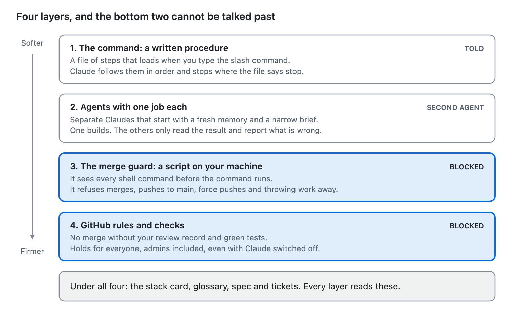
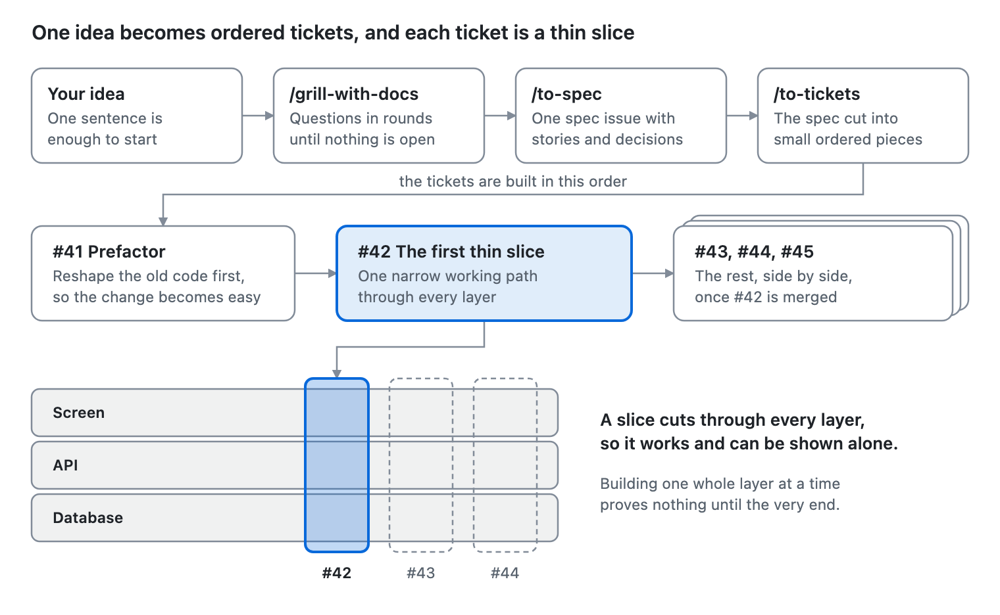
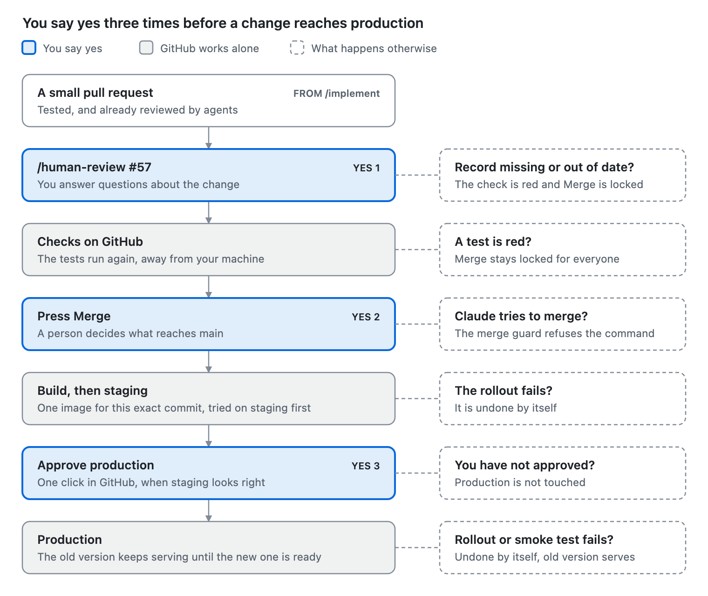

# How it works, in plain words

Every pipeline command, explained simply: what it does, why it exists, how it works, and which agent mistake it stops.
Read this first. [PIPELINE.md](PIPELINE.md) then walks through every step in full, with one example feature. The parts
around the flow (the stack pack, the add-ons, the agents and the learning kit) are in
[BEYOND-THE-FLOW.md](BEYOND-THE-FLOW.md).

**Jump to:** [The problem](#the-problem-these-commands-solve) · [One picture](#the-whole-pipeline-in-one-picture) ·
[A command versus just typing](#a-command-versus-just-typing) · [Set up](#set-up-once-pipelinesetup-project) ·
[Plan](#plan-grill-with-docs-to-spec-to-tickets) · [Build](#build-pipelineimplement-42) ·
[Check and ship](#check-and-ship-human-review-merge-github-actions-deploy) ·
[Any time](#any-time-next-project-explorer-retro) · [What stops each problem](#each-agent-problem-and-what-stops-it) ·
[Where the ideas came from](#where-the-ideas-came-from) · [Cheat sheet](#cheat-sheet)

## The problem these commands solve

An agent given one big request and full freedom goes wrong in five ways. Every pipeline command exists to stop at least
one of them.

| What goes wrong | What it looks like for you |
| --- | --- |
| It guesses what you meant | You asked for one thing and got a slightly different thing, described in its words, not your project's |
| It changes too much at once | Dozens of files change in one go and you cannot tell which changes matter |
| It touches things it should not | Unrelated files are edited, renamed or deleted, and something far away breaks |
| It says "done" and you have to believe it | Nothing proves the work is right, and the agent that wrote it is the one judging it |
| It forgets | A new session knows nothing about what was decided yesterday |

The pipeline does not make the agent smarter. It makes the work small, written down and checked by someone other than
the author, so a mistake is caught early and stays cheap.

## The whole pipeline in one picture

An idea reaches production through ten small steps, and each step leaves a record that the next step reads.

<picture>
  <source media="(prefers-color-scheme: dark)" srcset="docs/assets/how-it-works/pipeline-dark.png">
  
</picture>

Read it top to bottom. The left column names the same stage in an ordinary software team. Nothing here is a new process:
it is the usual one, with Claude doing the typing and you holding the decisions.

Three ideas carry the whole thing:

- **Small.** Work is cut into tickets, and a ticket becomes one pull request you can read in minutes.
- **Written down.** Each step leaves a file or a GitHub issue. The next step reads that, not an old chat.
- **Checked by someone else.** The agent that builds is never the one that judges, and the last check is always you.

## A command versus just typing

A slash command is a written procedure, not a cleverer prompt. When you type a sentence, Claude decides for itself how
to do the work, and decides differently each time. When you type `/pipeline:implement #42`, a file of steps loads, and
Claude follows those steps in that order.

A procedure alone would still be trust. So each command stands on three more layers.

<picture>
  <source media="(prefers-color-scheme: dark)" srcset="docs/assets/how-it-works/layers-dark.png">
  
</picture>

The top two layers make good work likely. The bottom two make the worst mistakes impossible, because they are not
Claude: one is a script, the other is GitHub.

|  | Just typing a request | A pipeline command |
| --- | --- | --- |
| How the work is done | Claude picks its own steps, differently each time | The same written steps, every time |
| What it knows about your project | Whatever it finds or guesses | The stack card, the glossary and the ticket |
| Size of the change | As big as the request | One ticket, one small pull request |
| Who checks the work | The agent that wrote it | Fresh reviewers, then you |
| What "done" means | Claude says so | A test failed, then passed, and a record exists |
| What it can do to `main` | Whatever your permissions allow | Nothing: merges and pushes to `main` are refused |
| Where the knowledge ends up | In a chat that ends | In the repo and on GitHub |

**You start every step.** Claude cannot decide to run `/implement` or `/human-review` on its own. Even `/next` only
names the command and waits for you to type it.

**Just typing is still fine for a tiny change.** Tiny means one idea, quick to review and cheap to redo, such as a label
or a failing test. Make the change, open a pull request, and go straight to your review.

## Set up once: `/pipeline:setup-project`

**In one line:** it writes down the facts about your project, so no later step has to guess them.

- **What it does.** Claude reads the repo, asks five questions in one round, shows the list of files it will write, and
  waits for your OK.
- **Why it exists.** An agent that does not know your test command, your stack or your rules will invent them. Written
  down once, every command reads the same facts.
- **How it works.** It writes a few small files. It writes no application code, and it leaves alone anything you did not
  ask it to change.
- **In a normal team:** the onboarding page and the team's working agreement.

The five questions are: which stack pack, which build mode, one glossary or several, the PR size budget, and whether to
add the PR checks. Each comes with a recommended answer, so "yes" is enough.

| File it writes | What it holds | Who reads it |
| --- | --- | --- |
| `docs/agents/stack.md` (the stack card) | Your real commands for test, lint and run, the build mode, the PR size budget | Every command and every agent |
| `CODING_STANDARDS.md` | Your rules for code | The project reviewer |
| `docs/agents/issue-tracker.md` and `domain.md` | Where tickets live and where the glossary lives | The planning commands |
| Two short blocks in `CLAUDE.md` | Pointers to the files above | Every session |
| `.github/workflows/pr-size.yml` and `human-review.yml` | Checks GitHub runs on every pull request | GitHub |

**Then lock `main`.** Once the setup is merged, `/pipeline:setup-project protect` adds a GitHub rule. Every change must
come through a pull request, your review record and the tests must be green, and nobody can force-push or delete `main`,
admins included. The command can only add protection. Loosening it stays with you, in GitHub's settings.

**More detail:** [0 Set up once](PIPELINE.md#0-set-up-once).

## Plan: `/grill-with-docs`, `/to-spec`, `/to-tickets`

Planning turns one sentence into small tickets, and no code is written until you have agreed every part.

<picture>
  <source media="(prefers-color-scheme: dark)" srcset="docs/assets/how-it-works/planning-dark.png">
  
</picture>

The ticket numbers are the library example from [PIPELINE.md](PIPELINE.md): #41 reshapes old code, #42 is the first thin
slice, and #43 to #45 follow once #42 is merged. The three commands run in one session, because each one reads the
conversation before it.

### `/pipeline:grill-with-docs <idea>`

**In one line:** Claude interviews you until nothing about the idea is left to guess.

- **What it does.** It asks numbered questions in rounds. Every question comes with a recommended answer, worded so that
  "yes" accepts it.
- **Why it exists.** Most rework starts with two people meaning different things by one word. An agent never says it is
  guessing. It just builds the guess.
- **How it works.** Facts are Claude's job, so it reads the code instead of asking you. Decisions are yours, so it asks
  and waits. It also checks what you say against the code, and tells you when the two disagree.
- **What it writes.** Each agreed word goes into `GLOSSARY.md` straight away, with the words to avoid. A decision that
  is hard to undo gets a short record in `docs/adr/`.
- **In a normal team:** the requirements meeting.

### `/pipeline:to-spec`

**In one line:** it writes up what you just agreed as one GitHub issue.

- **What it does.** It asks no new questions. It writes the problem, the solution, the user stories, the decisions made,
  and what is out of scope.
- **Why it exists.** A conversation is not a record. The spec is what the builder is later held to, and "out of scope"
  is what lets a reviewer say "nobody asked for this".
- **How it works.** It agrees with you where the feature will be tested, then publishes the issue. It leaves out file
  paths and code on purpose, because those go out of date quickly.
- **In a normal team:** the requirements document.

### `/pipeline:to-tickets`

**In one line:** it cuts the spec into tickets small enough to build and review one at a time.

- **What it does.** It proposes a numbered list. Each ticket has a title, what it delivers, and which tickets must
  finish first. You approve the list before anything is published.
- **Why it exists.** A small ticket produces a small change. This is the main defence against the forty-file surprise.
- **How it works.** Each ticket is a thin slice through every layer, sized to fit one fresh session. Reshaping old code
  comes first as its own ticket. Each ticket carries a checklist that later decides whether it is done.
- **In a normal team:** breaking the work down in sprint planning.

**More detail:** [1 Plan the language](PIPELINE.md#1-plan-the-language) and [2 Event
Storming](PIPELINE.md#2-event-storming).

## Build: `/pipeline:implement #42`

**In one line:** it turns one ticket into one small pull request that is already tested and reviewed, and then it stops.

<picture>
  <source media="(prefers-color-scheme: dark)" srcset="docs/assets/how-it-works/implement-dark.png">
  
</picture>

The picture shows one ticket in one fresh session. Fixes get one re-check and no third round: whatever is still open
goes to you.

- **What it does.** The seven steps above, in that order, for a single ticket.
- **Why it exists.** Building is where an unguided agent does the damage: too many files, no proof, and only its own
  word that it works.
- **How it works.** Claude in your session runs the procedure and hands the typing to a separate builder agent. The
  reviewers are other agents again. None shares a memory with the others, so nobody defends their own work.
- **In a normal team:** a developer builds test-first, opens a pull request, and colleagues review it.

### The four ideas inside it

1. **Read it cold.** An agent that never saw the planning restates the ticket. If its version differs from what you
   meant, the ticket is unclear, and you fix that before any code exists.
2. **Red, then green.** Each behaviour starts as a test that fails, followed by just enough code to pass it. Both runs
   are kept as proof. A test written after the code tends to agree with the code, right or wrong.
3. **Two reviewers who know different things.** The project reviewer knows your rules and your ticket. The blind
   reviewer reads no documentation and is never told what the feature is for, so it judges what the code does. In
   blind-graded tests, each caught defects the other missed.
4. **Findings need proof.** A reviewer can be wrong too. Claude confirms each must-fix in the code before anyone fixes
   it, and "it was intended" does not count as evidence.

### Three build modes

The mode decides who writes the code. You chose a default in `/setup-project`, and you can override it for one ticket:
`/pipeline:implement #42 deliver`.

| Mode | Who writes the code | Where you step in |
| --- | --- | --- |
| learn | You | Claude gives hints, smallest first, and its reviews teach |
| build-with-me | Claude, one block of about 60 lines at a time | After every block you reply OK, CHANGE, MINE or WHY |
| deliver | A fresh builder, the whole ticket, in its own separate copy of the repo | At the start, and again at your review |

### What the builder must ask before doing

- Adding or upgrading a dependency.
- Deleting files, renaming modules, or changing the build beyond the ticket.
- Anything outside your machine: deploying, shared databases, real secrets. These it never does.

It also ends every job with a list of each file it changed, one line each, saying what and why. Merging, pushing to
`main` and throwing work away are not left to trust: the merge guard blocks them.

**More detail:** [3 Test-first build](PIPELINE.md#3-test-first-build-with-container-tests), [4 A small
PR](PIPELINE.md#4-a-small-pr) and [5 Two reviewer agents](PIPELINE.md#5-two-reviewer-agents).

## Check and ship: `/human-review`, Merge, GitHub Actions, `/deploy`

You say yes three times before a change reaches production, and Claude cannot give any of the three for you.

<picture>
  <source media="(prefers-color-scheme: dark)" srcset="docs/assets/how-it-works/ship-dark.png">
  
</picture>

The dashed boxes are the point of the whole pipeline: at every step, the wrong thing has somewhere safe to stop.

### `/pipeline:human-review #57`

**In one line:** it makes sure you understand the change before you merge it.

- **What it does.** It shows what changed, then asks you questions. Explain this part. Predict what happens if two
  requests arrive at once. Who else is affected? How would you roll it back?
- **Why it exists.** "Looks fine" on code you did not write is where agent mistakes slip through. Answering questions
  shows whether you really know what is about to ship.
- **How it works.** It checks each answer against the code and says what you missed, with the file and line. For a
  prediction, it runs the test so you see whether you were right.
- **How deep it goes.** A change that is easy to undo and touches little gets 2 questions. A change that is hard to
  undo, touches a lot, or edits the checks themselves gets a full report and 5 to 8 questions.
- **What you get.** A review record posted on the pull request, naming the exact commit. Any new commit makes it stale,
  and the check goes red until you review again.
- **In a normal team:** the senior engineer's sign-off.

You also decide each question the reviewers left open: fix it now, make a follow-up ticket, or accept it.

### Press Merge

**In one line:** a person decides what reaches `main`, and that is enforced, not requested.

- **What stops Claude.** The merge guard is a script that reads every shell command before it runs. It refuses a merge,
  a push to `main`, a force push, a change to branch protection, and commands that discard work.
- **What it still allows.** Pushing a feature branch and opening a pull request, because that is how work reaches you.
- **The second lock.** GitHub's own rule refuses the merge without a current review record and green tests.
- **In a normal team:** the release decision.

### GitHub Actions: you type nothing

**In one line:** machines do the repeatable part, the same way every time.

- **On every pull request.** It runs lint and all the tests, labels an oversized pull request, and checks for your
  review record.
- **After the merge.** It builds one image for that exact commit and releases it to staging. After your approval it does
  the same for production.
- **Why it is not Claude.** A release should not depend on an agent's mood. Secrets live in GitHub and never pass
  through Claude.
- **In a normal team:** the CI/CD pipeline.

### `/pipeline:deploy`: once, before the first release

**In one line:** it sets up the release path, so later releases need no command at all.

- **What it does.** It writes the release files: the Dockerfile, the Kubernetes files for staging and production, and
  the deploy workflow. A deploy reviewer checks them, and they arrive as a normal pull request.
- **What stays yours.** Cluster access, secrets, the production approval and DNS. A guided script walks you through them
  in your own terminal, so secret values never reach Claude.
- **What it never does.** It applies nothing to a cluster and pushes no images. With no cluster chosen yet, it stops and
  suggests a research ticket to pick one.
- **In a normal team:** the platform setup done once by DevOps.

**More detail:** [6 Your review](PIPELINE.md#6-your-review), [7 You merge](PIPELINE.md#7-you-merge), [8 GitHub
Actions](PIPELINE.md#8-github-actions) and [9 Kubernetes](PIPELINE.md#9-kubernetes).

## Any time: `/next`, `/project-explorer`, `/retro`

These three are not steps in the line. You use them when you are lost, when the code is new to you, and when the same
mistake keeps coming back.

### `/pipeline:next`

**In one line:** it tells you which step you are on and the one command to type next.

- **What it does.** A script reads the repo's real state: open pull requests and their review records, ready tickets,
  specs, and the tests on `main`. It then names one command.
- **Why it exists.** Work is spread over tickets, branches and pull requests, and you should not have to hold it in your
  head. Claude's memory of an old chat is not a reliable record either.
- **How it works.** It checks from production backwards, so work that is nearly shipped comes before new work. It
  changes nothing, and it never runs the next command for you.
- **In a normal team:** a look at the board at stand-up.

### `/pipeline:project-explorer`

**In one line:** it explains a codebase by running it, so you understand the code before anyone changes it.

- **What it does.** It surveys the code, runs the app, and builds a page at `docs/explorer/explorer.html`. The page has
  a map of the system and each flow step by step, with real captured data and a breakpoint proved to hit.
- **Why it exists.** In a project you did not write, an agent's changes cannot be judged until you know how a request
  moves through the code. In a codebase that already exists, this is the first command you run.
- **How it works.** It stops and asks you which flows to cover. It writes only its own folder and the debugger settings.
  A bug it finds is reported with a way to reproduce it, never fixed on the spot.
- **In a normal team:** the architecture walkthrough a new joiner gets in week one.

### `/pipeline:retro`

**In one line:** it turns a mistake you corrected twice into a rule, so you never correct it a third time.

- **What it does.** It reads the session logs and pull request comments and proposes changes. You choose which ones to
  apply.
- **Why it exists.** Telling an agent "don't do that" in chat is lost when the session ends. A rule in the repo is still
  there next week.
- **How it works.** A mechanical mistake becomes an automated check. A matter of judgement becomes a line in
  `CODING_STANDARDS.md`, which the reviewer reads. Old code that taught the agent the bad habit gets fixed.
- **In a normal team:** the sprint retrospective.

**More detail:** [Where do I start?](PIPELINE.md#where-do-i-start), [An existing
project](PIPELINE.md#an-existing-project) and [Keep improving](PIPELINE.md#keep-improving).

## Each agent problem, and what stops it

Every problem has a named stop, and the stops come in three strengths. **Told** means Claude follows a written rule.
**Second agent** means a different agent, with a fresh memory, checks the first one. **Blocked** means a script or
GitHub refuses, whatever Claude says.

| The problem | What stops it | Strength |
| --- | --- | --- |
| It guesses what you meant | `/grill-with-docs` asks until nothing is assumed. Before building, a fresh agent restates the ticket in its own words, so you can compare it with what you meant | Told, and you approve |
| It does not know your project | The stack card, coding standards, glossary and decision records sit in the repo. Every command reads them | Told |
| It changes too many files at once | Tickets are thin slices. A pull request has a budget of about 400 lines, and Claude proposes a split above it. In build-with-me mode it writes about 60 lines, then waits for your OK | Told. GitHub labels an oversized PR |
| You cannot tell what it changed | The pull request shows the change as pseudo-code, the proof, and the danger of merging. `/human-review` then asks you questions and checks your answers against the code | Blocked: no merge without your review record |
| It edits things nobody asked for | The builder's rules forbid drive-by refactors and unrelated formatting. The spec reviewer reports anything "not asked for". A bug in untouched code becomes a new ticket, not a quiet fix | Second agent |
| It deletes files or throws work away | The builder must ask before deleting a file, renaming a module or adding a dependency. The merge guard refuses `git reset --hard`, `git clean -f`, `git checkout .`, `git restore .`, `git branch -D` and force pushes | Asking is told. The git commands are blocked |
| It breaks something far away | Tests run against a real database in containers. GitHub runs them again on every PR. Releases go to staging first and undo themselves on failure | Blocked on GitHub |
| It says "done" with no proof | Each behaviour starts as a failing test. The failing run and the passing run are both kept and shown in the PR | Told, and you can see the proof |
| It marks its own homework | Two reviewers start with a fresh memory. One knows your rules, one sees only the code. A reviewer that crashes is reported as "not run", never as "clean" | Second agent |
| It ships without you | Claude cannot merge or push to `main`. GitHub needs your review record and green tests. Production waits for your approval | Blocked |
| It forgets between sessions | Everything a step needs is on GitHub or in the repo, never only in a chat. `/next` rebuilds the picture from that | By design |

**What is still on trust.** A "told" rule can be broken by an agent on a bad day. That is why every told rule has a
second agent or a block behind it, and why the change reaches you small enough to read.

## Where the ideas came from

The planning half is Matt Pocock's work, copied unchanged. The half about not trusting the agent is ours.

[mattpocock/skills](https://github.com/mattpocock/skills) describes itself as skills "to do real engineering - not vibe
coding", kept "small, easy to adapt, and composable". Its README names four ways agents fail, and each has a matching
skill.

| Failure the README names | His fix | Where you meet it here |
| --- | --- | --- |
| The agent didn't do what I want | A relentless interview before any code | `/grill-with-docs` |
| The agent is too wordy, with no shared language | A glossary built during the interview | `GLOSSARY.md`, written by `/grill-with-docs` |
| The code doesn't work | Test-first building and a strict way to diagnose bugs | Inside `/implement` |
| We built a ball of mud | A spec that makes you think about the modules you touch | `/to-spec`, `/to-tickets` |

Fifteen of his skills sit in the kit exactly as he wrote them, pinned to his commit `4ae2317` of 31 October 2026. A
script checks they still match.

| Part | Origin |
| --- | --- |
| `/grill-with-docs`, `/to-spec`, `/to-tickets`, `/retro` | Matt Pocock, unchanged |
| The test-first rules and the pull request layout used by `/implement` | Matt Pocock, unchanged |
| The merge guard | Adapted from his `git-guardrails-claude-code` |
| `/setup-project` | Ours, using his tracker and glossary templates |
| `/implement`, `/human-review`, `/deploy`, `/next`, `/project-explorer` | Ours |
| The builder and the reviewer agents | Ours |

**What we added on top.** His skills get the plan right and the tests honest. Ours add the checks around the agent: two
reviewers with fresh memories, your review record tied to a commit, the rule on GitHub that protects `main`, and the
release steps.

## Cheat sheet

If you remember one thing: type `/pipeline:next` and it names the command for where you are.

| When | You type | You end up with |
| --- | --- | --- |
| Once per repo | `/pipeline:setup-project` | The project's facts on file, PR checks, then a protected `main` |
| The code is new to you | `/pipeline:project-explorer` | A page that walks each flow with real data |
| You have an idea | `/pipeline:grill-with-docs <idea>` | Agreed words in `GLOSSARY.md`, big decisions recorded |
| The idea is agreed | `/pipeline:to-spec` | One spec issue on GitHub |
| The spec exists | `/pipeline:to-tickets` | Small tickets, in the order they can be built |
| A ticket is ready | `/pipeline:implement #42` | A small, tested, reviewed pull request |
| A pull request is open | `/pipeline:human-review #57` | Your review record on the exact commit |
| The review is green | Press Merge on GitHub | The change on `main`, then staging by itself |
| Staging looks right | Approve production on GitHub | The change live |
| Before the first release | `/pipeline:deploy` | The release files and a guided setup script |
| The same mistake came back | `/pipeline:retro` | A new check or a new written rule |
| You are lost | `/pipeline:next` | Your step and one command |

**One step, one session.** Start each command in a fresh session with `/clear`. The one exception is planning:
`/grill-with-docs`, `/to-spec` and `/to-tickets` share a session, because the spec is written from that conversation.
