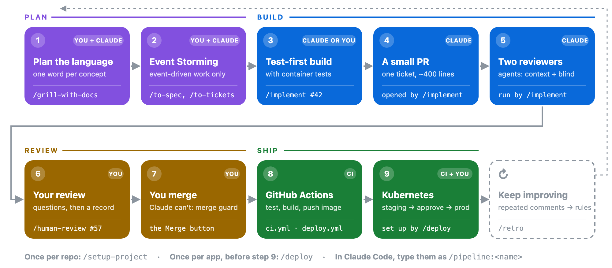
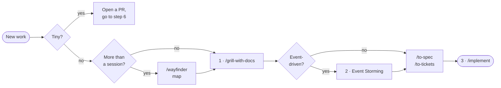
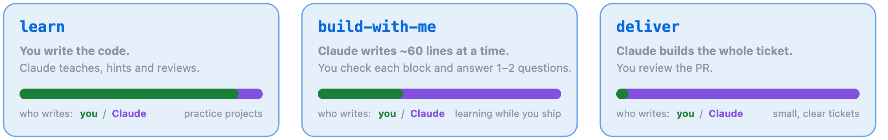

# The flow, step by step

<p align="center"></p>

Every step below has the same shape: why it exists, what you type, what Claude does, what you do, what you get, and
how you know it's done. One **example feature** runs through all nine steps:

> 📚 **The example:** a library app. *Members can reserve a title when every copy is out, and are told when a copy is
> set aside for them.*

The pills on each card say **who acts**: **YOU**, **CLAUDE**, or **CI** (GitHub Actions).

**Jump to:** [0 Set up](#0-set-up-once) ·
[1 Plan](#1-plan-the-language) · [2 Event Storming](#2-event-storming) · [3 Build](#3-test-first-build-with-container-tests) ·
[4 PR](#4-a-small-pr) · [5 Reviewers](#5-two-reviewer-agents) · [6 Your review](#6-your-review) ·
[7 Merge](#7-you-merge) · [8 Actions](#8-github-actions) · [9 Kubernetes](#9-kubernetes) ·
[Keep improving](#keep-improving) · [When something goes wrong](#when-something-goes-wrong) · [Reference](#reference)

### The whole flow in commands

```text
/pipeline:setup-project              once per repo
/pipeline:grill-with-docs <idea>     1     plan the language (step 2 joins in for event-driven work)
/pipeline:to-spec                    2     the plan becomes a spec issue
/pipeline:to-tickets                 2     ...and the spec becomes small tickets
/pipeline:implement #42              3–5   build test-first, open a small PR, two reviewers
/pipeline:human-review #57           6     your review
  press Merge on GitHub              7     only you can
  nothing: GitHub Actions runs       8–9   test, build, staging, your approval, production
/pipeline:deploy                     once, before the first release
/pipeline:retro                      now and then
/pipeline:next                       any time: where am I, and what do I type next?
```

### Where do I start?

**Already under way?** Type `/pipeline:next`. It reads the open PRs and their review records, the ready tickets, specs
and maps, and CI on `main`. Then it shows which step you're on and names one command. Work closest to production comes
first, so what's in flight finishes before something new starts. It changes nothing.

```text
Step 6 of 9 · Your review · you/library on main · deliver mode

Plan → Storm → Build → PR → Agents → [Your review] → Merge → Actions → K8s

Next: /pipeline:human-review #57
"Reserve a title" has no review record for its head commit 1a2b3c4 yet.

Also open
- Step 3 · /pipeline:implement #43: "Notify the member" is ready: nothing blocks it.
```

**Starting something new?**



**Tiny** means one idea that's quick to review and cheap to redo, like fixing a label or a failing test. **Event-driven**
means several actors, things that happen over time, and background reactions. **More than a session** means more fog
than one conversation can clear, or a need to research or prototype before deciding.

---

## 0. Set up once

**Give the repo what every step needs to know:** its stack, its commands, its tracker and how much code you want to
write yourself.

| | |
|---|---|
| **You&nbsp;type** | `claude plugin marketplace add myhts/claude-kits --scope project` and `claude plugin install pipeline@kits --scope project` in a terminal, then `/pipeline:setup-project` in Claude Code |
| **Claude** | looks at the repo (stack, existing commands, CI, docs), then asks **five questions in one round**: pack, build mode, domain layout, PR budget, CI checks. Each comes with a recommended answer |
| **You** | answer, or say "yes" to take the recommendations. Then approve the list of files it will write |
| **You&nbsp;get** | the stack card `docs/agents/stack.md` (commands, mode, budget, deploy target), `CODING_STANDARDS.md`, the tracker and domain notes, two short blocks in `CLAUDE.md`, the PR checks (`pr-size`, `human-review`, and `ci.yml` if you had none), the labels the planning steps use and, once the setup is on `main`, a GitHub ruleset that protects it |
| **Done&nbsp;when** | every command in the stack card has run once, or says "not set up yet" |

**Then protect `main`.** Once the setup is merged, `/pipeline:setup-project protect` adds a GitHub ruleset: every
change goes through a PR, the `human-review` check and CI must pass, and nobody can force-push or delete `main`, admins
included. It's free on public repositories. When CI gains a job later, `/pipeline:next` names it and the same command
adds it. Loosening the ruleset or switching it off stays yours, in Settings → Rules.

<details>
<summary><b>Tips and variations</b></summary>

- **Spring Boot repo:** `/setup-project` also installs the `spring` pack, which adds the Spring review checklist and
  verified build and deploy templates.
- **Any other stack:** everything works the same. With no pack, the stack-specific knowledge lives in
  `CODING_STANDARDS.md`; `/setup-project` offers to write the stack's main rules there.
- **A new Spring Boot project from scratch:** clone this repo and run `./new-project.sh my-app --pipeline`.
- **Your teammates** get the same plugins automatically: the choice is saved in the repo's `.claude/settings.json`.

</details>

---

## 1. Plan the language


**Agree what things are called before any code exists.** One word per concept, used everywhere: in code, tests, the UI
and tickets. Most rework starts with two people meaning different things by the same word.

| | |
|---|---|
| **You&nbsp;type** | `/pipeline:grill-with-docs` followed by the idea in a sentence |
| **Claude** | reads the code, then asks questions in rounds, each with its recommended answer. It tests every term against awkward scenarios, and writes things down the moment they're settled |
| **You** | answer, or say "yes" to accept a recommendation. You approve every term |
| **You&nbsp;get** | `GLOSSARY.md`: each term, what it means, and the words to *avoid*. Plus a short ADR in `docs/adr/` for any decision that is hard to reverse, surprising without context, and a real trade-off |
| **Done&nbsp;when** | you'd describe the feature in the same words the code will use, and no question is left open |

> 📚 **In the example:** is it a *reservation*, a *hold* or a *booking*? You settle on **Reservation** for the member's
> request (*avoid*: hold, booking) and **set aside** for a copy waiting on the shelf. "A member reserves, a copy is set
> aside, they don't collect it in 7 days: what happens?" becomes one ADR: **the copy passes to the next reservation in
> the queue.**

<details>
<summary><b>Tips and variations</b></summary>

- **The code already uses other words?** The rename lands as its own small PR *before* the feature.
- **Too much fog for one session?** Say "let's turn this into a map". `/wayfinder` creates a map issue with decision
  tickets: grilling, research (runs in the background), prototype (throwaway variants on a branch), and task. You work
  one ticket per session until no fog is left.
- **Don't let the agent own the glossary.** It proposes; you decide.

</details>

---

## 2. Event Storming


**For event-driven work, map what happens over time before designing code.** That means several actors, things that
happen later, and background reactions. It pays off there, and only there. A form that saves a record doesn't need it.

| | |
|---|---|
| **You&nbsp;type** | nothing new. When the domain is event-driven, the `event-storming` skill joins the step 1 session |
| **Claude** | walks three levels with you. The **big picture**: the timeline of events and the hotspots. The **process**: command → event → policy → next command. The **design**: one card per command, each with Given/When/Then specs. A fresh subagent then checks the whole model for contradictions |
| **You** | correct the timeline, resolve hotspots, and approve the cards |
| **You&nbsp;get** | `docs/eventstorming/01–04`: the board, the processes, the command cards and their specs. The specs become tests in step 3 |
| **Done&nbsp;when** | the consistency check comes back clean |

> 📚 **In the example:** *Reserve title* → **ReservationPlaced**. *Copy returned* → policy "set it aside for the next
> reservation" → **CopySetAside** → policy "notify the member". After 7 days uncollected, the copy goes to the next
> reservation in the queue.

### Then, for every feature: spec and tickets

Event-driven or not, the plan becomes small tickets before any code is written.

| | |
|---|---|
| **You&nbsp;type** | `/pipeline:to-spec`, then `/pipeline:to-tickets` |
| **Claude** | writes a **spec issue** from the conversation (user stories, decisions, out of scope), and agrees with you **where to test**. Then it cuts the spec into thin vertical slices with blocking links: a prefactor first if the code needs reshaping, then a tracer bullet through every layer, then tickets that can run in parallel |
| **You&nbsp;get** | GitHub issues, ready for `/implement` |
| **Done&nbsp;when** | you've approved the seams and the size of each ticket |

> 📚 **In the example:** #41 pulls the queue logic out of the loan service (prefactor). #42 is the tracer bullet:
> *Reserve title* → **ReservationPlaced** → "My reservations" shows it. #43–#45 can then run in parallel.

---

## 3. Test-first build with container tests


**Every behaviour starts as a failing test.** The tests run against the real database and services in containers, so
green means it works rather than that a mock agreed.

| | |
|---|---|
| **You&nbsp;type** | `/pipeline:implement #42` (add a mode to change it for this ticket: `/implement #42 deliver`) |
| **Claude** | restates the ticket, and a fresh agent that wasn't in the planning reads it cold: what it thinks the ticket asks, and the decisions the ticket leaves open. Then Claude proposes the seams to test at, and builds one vertical slice at a time: **red, then green**. Tests go through public interfaces with Testcontainers, and mocks sit only at the system's edges. It finishes with lint and the full verify |
| **You** | settle the open decisions (the answers go on the ticket) and agree the seams. What else you do depends on the mode (below) |
| **You&nbsp;get** | a branch `ticket/42-…` whose tests went red first and then green, with the evidence kept for the PR |
| **Done&nbsp;when** | the acceptance criteria pass at the agreed seams, and the full verify is green |



- **learn:** you write the code. Claude gives hints, smallest first, and its reviews teach.
- **build-with-me:** Claude first suggests which blocks you write yourself: the ideas new to you, such as a prompt, a
  tool description or an eval case. Then it writes the others, one block of at most about 60 lines at a time, and asks
  you one question about each. You reply
  **OK**, **CHANGE** (say what), **MINE** (you write it, and it's reviewed in teaching mode) or **WHY** (the mentor
  explains).
- **deliver:** a fresh implementer builds the whole ticket in its own worktree.

> 📚 **In the example (build-with-me):** block 1 is the `Reservation` decider and its first Given/When/Then test, red
> then green. The question: *"two members reserve the last title at the same moment: what does the second one see?"*
> Your answer is checked against the code, and you reply **OK**.

---

## 4. A small PR


**One ticket, one PR, one idea.** A small PR gets a real review; a big one gets skimmed.

| | |
|---|---|
| **You&nbsp;type** | nothing: `/implement` does it |
| **Claude** | counts the changed lines against the budget (about 400; lockfiles, generated code and snapshots don't count). Over budget, it proposes a split before anything is opened. It writes the PR body, then opens the PR after step 5 |
| **You&nbsp;get** | a PR whose body has three parts. **Summary:** the change as pseudo-code. **Evidence:** which test failed before and passes now. **Merge danger:** whether it's a one-way or two-way door, and how big the blast radius is |
| **Done&nbsp;when** | the PR is open, under budget, with the ticket linked |

> 📚 **In the example:**
>
> ```markdown
> ## Summary
> reserveTitle(member, title)
>   if a copy is on the shelf → refuse "Borrow it instead"
>   if member already reserved this title → refuse
>   append ReservationPlaced, position = queue length + 1
> ## Evidence
> Before: ReservationTest > places a reservation when no copy is free: failed (no such command)
> After:  passes; 14 tests, Postgres in Testcontainers
> ## Merge danger
> Door: two-way (a new table, no data changed) · Blast radius: small
> ```

<details>
<summary><b>Tips and variations</b></summary>

- **Over budget anyway?** CI labels the PR `size/large` and asks for a reason. It never blocks.
- **Reshaping code first?** That's its own PR, merged before the behaviour change.
- **A wide refactor** goes expand → migrate in batches → contract, one PR each.

</details>

---

## 5. Two reviewer agents


**Two reviewers who know different things.** One knows the project and checks it against what you wrote down. The other
knows nothing about the project and checks the code against published practice. In blind-graded tests, each caught
defects the other missed.

| | |
|---|---|
| **You&nbsp;type** | nothing: `/implement` runs them in parallel before the PR opens |
| **Claude** | **`code-reviewer`** runs twice. On **standards**, it checks `CODING_STANDARDS.md`, the pack's checklist, the glossary's *avoid* words and a code-smell baseline. On **spec**, it checks the ticket, spec and event model for anything missing, extra or wrong. **`blind-reviewer`** sees only the code. **`security-reviewer`** (**`spring-security-reviewer`** in a Spring project) and **`deploy-reviewer`** join when the change touches their area. Claude then confirms each must-fix in the code, a fresh implementer fixes the confirmed ones, and the reviewers read the fixes once more, and only once. A bug in code the PR didn't touch becomes a proposed follow-up ticket instead |
| **You&nbsp;get** | a PR you see only after its confirmed must-fix findings are fixed, plus a list of **judgement calls** left for you, including any finding Claude contested and why |
| **Done&nbsp;when** | the fixes have had their one re-review, and anything still open is on your list |

> 📚 **In the example:** `code-reviewer` (standards) flags `HoldQueue`, because "hold" is on the glossary's avoid list,
> so it becomes `ReservationQueue`. `blind-reviewer` finds that two simultaneous reservations can both get position 1;
> the fix adds a unique constraint and a test. One judgement call goes to you: show queue positions to members, or not?

---

## 6. Your review


**You understand the change before it ships.** Claude asks you questions about the change and checks your answers
against the code. The depth depends on the risk.

| | |
|---|---|
| **You&nbsp;type** | `/pipeline:human-review #57` |
| **Claude** | shows what changed and what it touches, then asks **questions**. *Explain* this part. *Predict* what happens if… (it then runs the test to check your answer). What's the *impact* on…? How would you *roll it back*? What would an *incident* look like? |
| **You** | answer, and decide each judgement call: fix now, a follow-up ticket, or accept |
| **You&nbsp;get** | a **review record** posted on the PR, naming the exact commit you reviewed. The `human-review` check turns green |
| **Done&nbsp;when** | every question is checked and every judgement call decided |

| The PR is… | Review |
|---|---|
| on a learning project | full, always |
| a one-way door (data loss, a sent message, a published contract, a destructive migration) or has a large blast radius | full: impact report and 5–8 questions |
| a change to the checks themselves: `.github/workflows/`, or the hooks and settings in `.claude/` | full: green checks can't vouch for a PR that changes them |
| a two-way door with a small blast radius | quick: check the evidence, 2 questions |

> 📚 **In the example:** a two-way door with a small blast radius, so a quick review. *Predict:* "two members reserve the
> last copy at once: what does the second one get?" You say "position 2". Claude runs the concurrency test, and it
> agrees.

**A new commit needs a new record:** the check goes red again until you review the latest commit.

---

## 7. You merge


**A person decides what reaches `main`.** That's the whole point of the flow, so it's enforced rather than just
requested.

| | |
|---|---|
| **You&nbsp;type** | press **Merge** on GitHub (or `gh pr merge` in your own terminal) |
| **Claude** | can't. The `pipeline` plugin's **merge guard** blocks merges, pushes to `main` or `master`, force pushes, changes to branch protection, and commands that throw work away. If Claude tries, it's told to ask you instead |
| **You&nbsp;get** | the change on `main`, which starts step 8 |
| **Done&nbsp;when** | merged |

The ruleset from step 0 adds GitHub's own check on top: no merge without a current review record and green CI.

---

## 8. GitHub Actions


**Machines do the repeatable part.** You never run a deploy by hand, and secrets never pass through Claude.

| | |
|---|---|
| **You&nbsp;type** | nothing |
| **CI** | **on every PR:** `ci.yml` runs lint and the full verify with container tests; `pr-size` labels big PRs; `human-review` checks for a current record. **On merge:** `deploy.yml` builds **one image per commit**, tags it with the commit SHA, and pushes it to GitHub's registry (GHCR) |
| **You&nbsp;get** | a tested image for exactly the commit you merged |
| **Done&nbsp;when** | the image is pushed, and step 9 starts |

Secrets live in GitHub Environments. The deploy setup in step 9 walks you through adding them in your own terminal.

---

## 9. Kubernetes


**Staging first, then production after your approval.** Every release follows the same steps, and a failed release
undoes itself.

| | |
|---|---|
| **You&nbsp;type** | nothing per release; approve the `production` environment in GitHub when asked |
| **CI** | applies the **staging** overlay (Kustomize) and waits for the rollout. It undoes the rollout if that fails, then runs the smoke e2e tests against staging. After your approval, it does the same for **production**, where it runs only smoke tests that don't create data (tests not tagged `@writes`) and undoes the rollout if they fail |
| **You&nbsp;get** | the change live, with the old version kept serving until the new one is ready |
| **Done&nbsp;when** | the production rollout is complete and its smoke test is green |

> 📚 **In the example:** the merge of #57 reaches staging in a few minutes and the smoke test reserves a title. You
> approve, and members can reserve titles in production.

**The first time:** run `/pipeline:deploy` once, before the first release.
- **No cluster chosen yet?** It suggests a research ticket, "Pick the Kubernetes host", which weighs cost, ingress and
  TLS, how CI signs in, and where the database lives.
- **Otherwise it writes the files:** the `Dockerfile`, `k8s/base`, `k8s/overlays/{staging,prod}` and
  `.github/workflows/deploy.yml`. It renders the overlays, has `deploy-reviewer` check them, and opens a PR.
- **Then a `wizard` script** walks you through the rest in your own terminal: the namespaces, the cluster credentials,
  image pulls, the production approval, app secrets, and DNS and TLS.

<details>
<summary><b>Rollback, database changes and how the templates are proved</b></summary>

- **Rollback** is automatic when a rollout or the production smoke test fails. By hand, run `kubectl rollout undo`, or
  re-run the deploy of the last good commit (`gh run rerun <run-id>`), which redeploys exactly that commit.
- **Database changes** go expand → migrate → contract, so the previous version still runs against the new schema and a
  rollback is always safe.
- **The templates are proved:** both overlays are validated against the Kubernetes 1.33 schemas, and the workflows are
  linted. A throwaway kind cluster checks three things: a rollout completes, a broken release leaves the old pods
  serving, and `rollout undo` restores the release.

</details>

---

## Keep improving

**Never leave the same review comment twice.** After a milestone, or as soon as you notice a repeat, type
`/pipeline:retro`. It reads the session logs and PR comments, and proposes changes:
- a mechanical rule becomes a CI check;
- a judgement call goes into `CODING_STANDARDS.md`;
- the old code that taught the agent the bad habit gets fixed.

You choose which changes to apply.

> 📚 **In the example:** you've twice flagged a test that inserted rows directly instead of going through the API. `/retro`
> turns it into a coding standard and fixes the tests the agent had been copying.

---

## When something goes wrong

| Symptom | Fix |
|---|---|
| `/pipeline:…` isn't in the menu | The plugin isn't enabled in this repo. Run `claude plugin list`, then the two commands in [step 0](#0-set-up-once), then `/reload-plugins` |
| "Blocked by the merge guard" | Working as intended. If you really want that command, run it yourself |
| A planning step can't create sub-issues or blocking links | `gh` is older than 2.94. Upgrade it (`brew upgrade gh`) |
| The `human-review` check stays red | No record names the latest commit. Run `/human-review` again after every new commit |
| The PR got `size/large` | Split it, or reply in the PR with the reason. The label never blocks |
| You disagree with a reviewer | Code smells are judgement calls: accept, defer or reject them in `/human-review`. If it's a standing preference, `/retro` writes it down |
| Wayfinder keeps adding tickets | That's the fog clearing, which is expected. Move tickets you don't want to "Out of scope" |
| A skill didn't load when expected | Name it ("use the tdd skill"). If it keeps happening, `/retro` sharpens the skill's description |

---

## Reference

<details>
<summary><b>What the merge guard blocks</b></summary>

`gh pr merge` and the merge API; pushes to `main` or `master` (including `HEAD:main` and a plain `git push` while on
`main`); force pushes and `+` refspecs; `--delete`, `--mirror`, `--prune` and `:branch` deletions; `git reset --hard`;
`git clean -f`; `git branch -D`; `git checkout .`; `git restore .` (unless only staged); `gh api` writes to rulesets
or branch protection, and the GraphQL mutations that change them. Pushing a feature branch, opening a PR, reading
protection and `/setup-project protect` (which only adds) still work.

</details>

<details>
<summary><b>Files the flow creates in your repo</b></summary>

| File | Written by | Read by |
|---|---|---|
| `docs/agents/stack.md` (the stack card) | `/setup-project` | every step and agent |
| `docs/agents/issue-tracker.md`, `docs/agents/domain.md` | `/setup-project` | the planning steps |
| `CODING_STANDARDS.md` | `/setup-project`, `/retro` | `code-reviewer` (standards) |
| `CLAUDE.md` blocks "Agent skills" and "Pipeline" | `/setup-project` | every session (pointers only) |
| `GLOSSARY.md` (or `GLOSSARY-MAP.md` for several contexts), `docs/adr/` | step 1 | everything that names things |
| `docs/eventstorming/01–04` | step 2 | `/to-spec`, `/to-tickets`, the spec review |
| the map, spec and tickets | GitHub Issues | the planning steps and `/implement` |
| `.github/workflows/pr-size.yml`, `human-review.yml`, `ci.yml`, `deploy.yml` | `/setup-project`, `/deploy` | GitHub Actions |
| `k8s/base`, `k8s/overlays/*` | `/deploy` | CI |
| `docs/learning/LESSONS.md`, `PROGRESS.md` | learning projects | `/implement`, the implementer |

</details>

<details>
<summary><b>Every command in the plugin</b></summary>

| Command | When |
|---|---|
| `/pipeline:setup-project` | once per repo |
| `/pipeline:grill-with-docs` | the start of any non-trivial work |
| `/pipeline:wayfinder` | work bigger than one session |
| `/pipeline:to-spec`, `/pipeline:to-tickets` | after the plan is agreed |
| `/pipeline:implement <ticket> [mode]` | per ticket |
| `/pipeline:human-review <PR>` | per PR |
| `/pipeline:deploy` | once, before the first release |
| `/pipeline:retro` | after a milestone, or a repeated comment |
| `/pipeline:next` | any time: which step you're on, and the one command to type next |

Skills the steps load by themselves: `event-storming`, `tdd`, `codebase-design`, `diagnosing-bugs`, `domain-modeling`,
`pr`, `research`, `prototype`, `wizard`. The slash menu finds every command as you type its short name.

</details>

Everything that isn't part of the flow, such as the Spring pack, the add-ons, the learning kit and how each agent works,
is in **[GUIDE.md](GUIDE.md)**.
