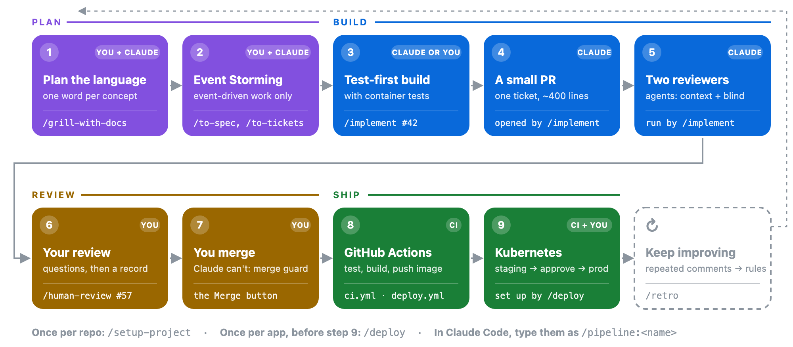
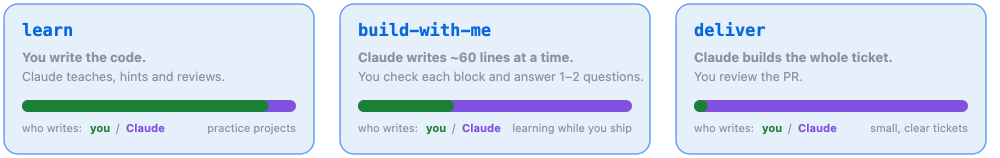

<h1 align="center">claude-kits</h1>

<p align="center">
  <b>Plan it. Build it test-first. Have it reviewed twice. Merge it yourself. Ship it to Kubernetes.</b><br>
  A delivery flow for <a href="https://claude.com/claude-code">Claude Code</a> that works on any stack.
</p>

<p align="center">
  
</p>

**You decide, Claude builds, CI ships.** Every step is one command. Each pull request is small and has been through two
reviewer agents before you see it. Claude can't merge, so nothing reaches production without your review.

## Start in three minutes

**1. Add the plugin** to any repository, in any language. You need Claude Code, `git`, `gh` 2.94 or later, and Docker:

```bash
claude plugin marketplace add myhts/claude-kits --scope project
claude plugin install pipeline@kits --scope project
```

**2. Set the repo up once.** Start `claude`, then:

```text
/pipeline:setup-project
```

It looks around, asks five questions in one round (each with a recommended answer), shows what it will write, then
writes it.

**3. Start your first feature** by describing it in a sentence:

```text
/pipeline:grill-with-docs Members want to reserve a title when every copy is out
```

From there, the flow below tells you what comes next.

## The flow, one step at a time

| | Step | You type | You get |
|:-:|---|---|---|
| **1** | [**Plan the language**](PIPELINE.md#1-plan-the-language) | `/grill-with-docs <idea>` | one agreed word per concept (`GLOSSARY.md`) and the decisions behind it (ADRs) |
| **2** | [**Event Storming**](PIPELINE.md#2-event-storming) | *(joins step 1 for event-driven work)*, then `/to-spec`, `/to-tickets` | the events, commands and rules, then small tickets on GitHub |
| **3** | [**Test-first build**](PIPELINE.md#3-test-first-build-with-container-tests) | `/implement #42` | code written test-first, with a real database in containers |
| **4** | [**A small PR**](PIPELINE.md#4-a-small-pr) | *(opened by `/implement`)* | one ticket's worth of change, with before-and-after evidence |
| **5** | [**Two reviewer agents**](PIPELINE.md#5-two-reviewer-agents) | *(run by `/implement`)* | the must-fix findings fixed before you look |
| **6** | [**Your review**](PIPELINE.md#6-your-review) | `/human-review #57` | a few sharp questions, then a review record on the PR |
| **7** | [**You merge**](PIPELINE.md#7-you-merge) | the Merge button | the change on `main`, decided by a person |
| **8** | [**GitHub Actions**](PIPELINE.md#8-github-actions) | *(nothing)* | tests on every PR; an image per commit on merge |
| **9** | [**Kubernetes**](PIPELINE.md#9-kubernetes) | approve in GitHub | staging, a smoke test, your approval, production |

**[PIPELINE.md](PIPELINE.md)** walks through every step with one example feature, from the first question to
production.

## Choose how much code you write

<p align="center"></p>

Pick the default in `/setup-project`. Change it for one ticket by adding a mode: `/implement #42 deliver`.

## Why you can trust what it ships

- 🛑 **Claude can't merge.** A hook blocks merges, pushes to `main` and force pushes. Your review leaves a record tied
  to the PR's latest commit, and a required check reads that record.
- ✂️ **Small PRs.** One ticket is one PR of about 400 lines, tested at seams you agreed on before any code was written.
- 👀 **Two reviewers that see different things.** One knows the project; the other reads only the code. In blind-graded
  tests, each caught defects the other missed.
- 🧪 **Proof before claims.** Code in the skills runs as tests, the deploy templates go through a real rollout and
  rollback, and a changed agent ships only after it scores at least as well as the version it replaces. See
  [what's proved, and what isn't yet](GUIDE.md#10-proofs).

## Beyond the flow

The **`spring`** pack adds Spring Boot 4 skills, a review checklist and verified build and deploy templates. Other add-ons cover
end-to-end tests with a browser (an MCP), Claude in your own services, and a React front end. There's also
`/project-explorer`, a learning kit for practice projects, and every agent and skill described one by one. All of it
is in **[GUIDE.md](GUIDE.md)**.

## Credits and licence

[Apache License 2.0](LICENSE). Fifteen skills come unchanged from [mattpocock/skills](https://github.com/mattpocock/skills)
(MIT) at a pinned commit. The Spring kit started from [piomin/claude-ai-spring-boot](https://github.com/piomin/claude-ai-spring-boot)
(Apache-2.0). [GUIDE.md](GUIDE.md#11-whats-ours-and-whats-adopted) lists which ideas are ours and which are adopted, and
[NOTICE.md](spring-boot-learning/NOTICE.md) records every change.
